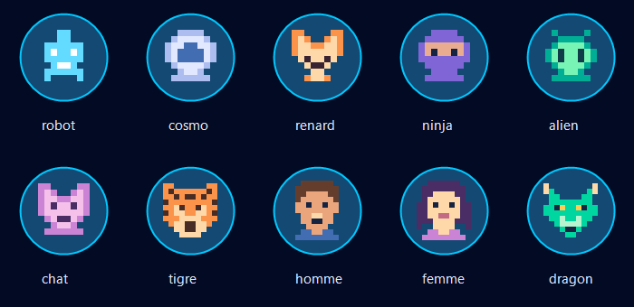

# Avatars pixel art

Les dix dessins sont stockés dans `public/avatars`. Robot, Cosmo, Renard, Ninja, Alien et Chat reprennent les carrés de la maquette Figma (nœud 43:7197). Tigre est un dessin supplémentaire sur la même grille, avec une fourrure orange, des rayures sombres et un museau clair.

Le catalogue est dans `src/features/profile/data/avatars.ts`. Le composant `ProfileAvatar` centralise le dessin, la bordure et le halo. Il accepte `avatarId`, `size`, `muted`, `decorative` et `className`.

Les tailles disponibles sont small (36px), medium (48px), large (64px) et preview (88px). Les emplacements particuliers règlent ensemble les variables CSS `--profile-avatar-size` et `--profile-avatar-scale` (taille / 48). Les SVG conservent leurs dimensions natives ; seule une transformation adapte leur affichage.

## Activer le tigre dans Supabase

Les six identifiants existants sont conservés. Le nouvel identifiant est `tigre`.

La migration `supabase/migrations/202610150001_add_tiger_avatar.sql` étend uniquement la liste des avatars autorisés. Elle ne modifie aucun profil ni aucune règle d’accès.

Cette migration locale doit être appliquée à la base du projet, via le processus habituel de migrations Supabase ou en exécutant son contenu dans l’éditeur SQL Supabase. Elle n’a pas été exécutée sur la base distante pendant cette modification. Avant son application, Supabase refusera l’enregistrement du tigre, y compris lors de la création d’un compte.

## Vérification visuelle

Cet aperçu permet de comparer les dessins ; le halo et les états interactifs restent à vérifier dans le navigateur.

## Homme, femme et dragon

Trois dessins complètent le catalogue : homme aux cheveux bruns, femme aux cheveux violets et dragon vert aux cornes claires. Ils utilisent les mêmes SVG de 48px et le même composant que les autres avatars.

Appliquer `supabase/migrations/202610150002_add_more_pixel_avatars.sql` pour autoriser leur enregistrement. Cette migration conserve les sept identifiants précédents, dont `tigre`. Elle n’a pas été exécutée sur la base distante pendant cette modification.
